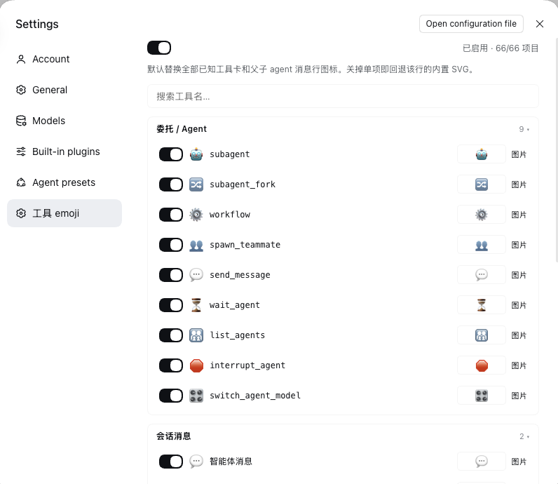

# dsh-tool-emoji

[中文](README.zh.md)

A [DeepSeek Harness](https://github.com/deepseek-ai/deepseek-harness) plugin that replaces tool-card and parent/subagent message icons with emoji.

**Platforms**: Web GUI (desktop also loads the web client; `dsh.client.platform` must be the string `"web"`)

## ✨ Features

- **On by default** — 90+ known tool cards, `send_message`, and agent-message rows
- **Search & filter** — Find tools by name or category
- **Grouped settings** — Delegation and Messages expanded; no Add step
- **Per-tool enable/disable** — Mix emoji with default icons
- **Custom emoji or images** — Upload PNG/JPEG/GIF/WebP/BMP (max 1MB, stored in localStorage)
- **Categorized UI** — Tools grouped by function (File operations, Shell, Web & search, etc.)
- **Zero-config defaults** — Popular tools work out of the box

## Default Mappings (90+ tools)

The plugin includes emoji mappings for 90+ tools across these categories:

| Category | Examples | Sample Emoji |
|---|---|---|
| **Reasoning** | `think` | 🤔 |
| **File operations** | `read`, `write`, `edit`, `grep`, `glob`, `read_image` | 🧐, ✍️, ✏️, 🔍, 📁, 🖼️ |
| **Shell** | `bash`, `pwsh` | 💻, 👨‍💻 |
| **Web & search** | `web_fetch`, `web_search`, `research`, `weather` | 🌐, 🔍, 📚, 🌤️ |
| **Delegation** | `subagent`, `send_message`, `spawn_teammate` | 🤖, 💬, 👥 |
| **Messages** | agent-message row, continuation receipt | 💬, ▶️ |
| **Job control** | `job_list`, `job_output`, `job_kill` | 📋, 📤, ❌ |
| **Memory** | `mnemon_recall`, `mnemon_remember`, `mnemon_document_search` | 🧠, 💭, 📄 |
| **Goals & tasks** | `create_goal`, `task_board_create`, `todo_write` | 🎯, 📋, 📝 |
| **Scheduling** | `schedule_create`, `schedule_list` | ⏰, 📅 |
| **Office** | `office_docx`, `office_xlsx`, `office_pptx` | 📄, 📊, 📊 |
| **Other** | `plugin_manager`, `list_subagent_models` | 🔌, 🏷️ |
| **Error state** | Any tool in error | 😫 |

See the complete list in the settings UI.

## Screenshots




## Installation

### Desktop App (GUI)

1. Open **Settings → Web Plugins** (or **Plugins**)
2. Click **+ Install from URL** (or equivalent add plugin button)
3. Enter: `https://github.com/godot42x/dsh-tool-emoji`
4. Click **Install**
5. Restart the application

### CLI (for Web profile or advanced users)

```sh
# from GitHub (this fork)
dsh plugin --profile web add git+https://github.com/godot42x/dsh-tool-emoji.git

# or from a local checkout
dsh plugin --profile web add file:./dsh-tool-emoji
```

Then restart the profile:

```sh
dsh --profile web
```

The plugin does not hot-reload into an already-running process — restart is required.

### Uninstall

- **Desktop**: Settings → Web Plugins → find `dsh-tool-emoji` → Remove
- **CLI**: `dsh plugin --profile web remove dsh-tool-emoji`

## How it works

- This plugin does **not** register `tool.call.toolview`, so it does not take over the original tool cards.
- It only injects a small global stylesheet (about 70 rules / 13 KB) that:
  - finds the leading cell (`[data-variant="<tool>"] > span[class*="leading"]`, plus the disclosure-row and `data-tool` layouts);
  - maps every tool to a custom property (`--dte-icon-<tool>`, read from `:root`) and draws the icon with one generic `::before`;
  - hides only the leading cell's first child (the built-in icon) and keeps the hover chevron;
  - preserves the title, summary, diff, terminal output, expand/collapse behavior, and all other card details.
- Editing an emoji writes that custom property on `document.documentElement`; the stylesheet is never rebuilt while typing (input is coalesced at 150 ms). Images stay base64 in localStorage but CSS only references a short `blob:` URL.
- When a tool card is in the error state, the leading error dot is replaced with the error emoji (default 😫).
- In DSH 0.2.2, parent↔subagent traffic shows up as delegation tool cards (`send_message`, `subagent`, `spawn_teammate`, `wait_agent`…), so those are the rows that get emoji. The `[data-turn-trigger]` / `[data-generation-continuation]` selectors are kept for builds that render dedicated message rows.

## Settings / Customization

In the DSH Settings page, open **工具 emoji** to customize every icon:

### Master controls
- Toggle the whole plugin
- Stats show enabled / total rows

### Grouped list
- Delegation and Messages start expanded
- Each row: toggle, preview, name, emoji, optional image
- Disable a row to restore its built-in SVG; no Add step

### Error state
- Emoji for tool cards in error (message rows have no error state)

### Reset
- Restore defaults

All changes **save automatically** to localStorage and **apply immediately** without page refresh.

## dsh-edit-guardian compatibility

If you also use `dsh-edit-guardian`, it replaces the built-in rows for `edit` / `str_replace_editor` / `pwsh` with its own custom DOM (`.dshg_row`).

To make the emoji apply to those custom rows too:

1. Use a `dsh-edit-guardian` build that exposes `data-tool` on `.dshg_row` (the local dev version already does);
2. Reinstall `dsh-edit-guardian` using the same source you installed it from, then reinstall this plugin;
3. Restart the Web profile.

If `dsh-edit-guardian` does not have the `data-tool` attributes, the emoji will not be applied to its custom rows.

## Adding custom tools

Settings lists 90+ known DSH tools plus agent-message rows. If you need a tool that's not in the list:

1. The plugin will still work if that tool uses standard `data-tool` or `data-variant` attributes
2. Unknown tools get a default emoji (🔧)
3. You can manually edit `ALL_KNOWN_TOOLS` in `lib/client.js` to add more tools

## Notes

- The selectors rely on official source-level data attributes from DSH
- If a future DSH version changes these DOM structures, the CSS selectors may need updates
- The plugin is Web-profile oriented; TUI/headless profiles have no icon UI surface
- Tool names are **case-sensitive** and must exactly match the DOM attribute
- Images are stored in localStorage as base64 — keep them under 1MB to avoid quota issues

## Migration from v1

This version (v2) uses a new storage key (`dsh-tool-emoji:config:v2`) and structure:

- **Old installs**: Your v1 settings won't migrate automatically. Use the visual tool picker to re-add tools.
- **Default behavior**: Tools must be explicitly added via the picker (no auto-enable).
- **90+ tools available**: Much larger pre-configured tool list.

## Changes from upstream

**Forked from**: [LWLAymh/dsh-tool-emoji](https://github.com/LWLAymh/dsh-tool-emoji)

**Why this fork?** The original repo is unmaintained and missing several DSH tools. This fork keeps the plugin alive and extends it to cover the full DSH ecosystem.

This fork adds:

1. **Missing tool coverage**
   - Added emoji for `read_image`, `sidebar_open`, `cordis_*`, and 30+ other tools that the upstream never covered
   - Comprehensive `view-*` sub-tool mapping for `mnemon_view_action` and `mnemon_view_route`

2. **Desktop platform support**
   - Upstream only worked in Web GUI
   - Now works in **both Web and Desktop** apps
   - Installation verified on DSH Desktop `0.2.1-rc.2`

3. **Complete tool picker** (90+ tools)
   - Visual tool browser with category grouping
   - Search and filter by tool name
   - One-click enable instead of manual `data-tool` entry

4. **Modern DSH compatibility**
   - Relaxed `peerDependencies` to support DSH `^0.2.0`:
     - `@deepseek-ai/cordis`: `^4.0.1 || ^5.0.0`
     - `@deepseek-ai/dsh-client-runtime`: `^0.1.1-rc.2 || ^0.2.0`
     - `react`: `^18.2.0 || ^19.0.0`
   - Tested on DSH `0.2.1-rc.2`

5. **Better UX**
   - Statistics dashboard (configured/enabled/available counts)
   - Grid layout with expand/collapse
   - Per-tool enable/disable toggles
   - Auto-save on every change

**License note**: This fork keeps MIT, matching the upstream's MIT license. The copyright attribution is preserved in `LICENSE`.

## License

MIT
