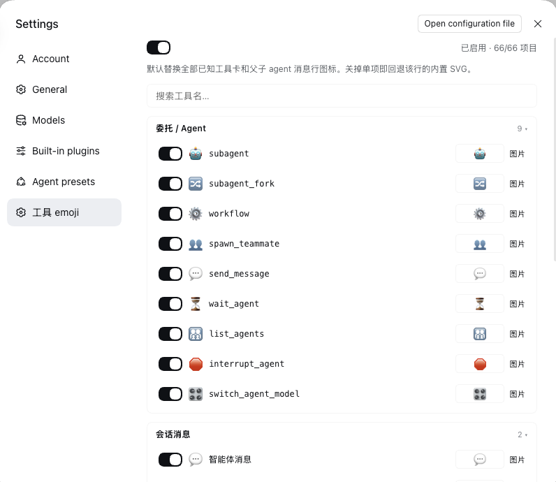

# dsh-tool-emoji

[English](README.md)

一个 [DeepSeek Harness](https://github.com/deepseek-ai/deepseek-harness) 插件：用 emoji 替换工具卡和父子 agent 消息行的图标。

**支持平台**：Web GUI（桌面应用也走 web client，`dsh.client.platform` 必须是字符串 `"web"`）

## ✨ 特性

- **默认全开** — 90+ 已知工具卡、`send_message`、智能体消息行都替换成 emoji
- **分组设置** — 委托 / 会话消息默认展开，其余按组折叠
- **搜索** — 按工具名或中文标签过滤
- **单独开关** — 关掉某一项即回退该行内置 SVG
- **自定义 emoji 或图片** — 上传 PNG/JPEG/GIF/WebP/BMP（最大 1MB，存在 localStorage）

## 默认映射（90+ 工具）

插件包含 90+ 工具的 emoji 映射，分为以下类别：

| 分类 | 示例 | Emoji 示例 |
|---|---|---|
| **推理** | `think` | 🤔 |
| **文件操作** | `read`, `write`, `edit`, `grep`, `glob`, `read_image` | 🧐, ✍️, ✏️, 🔍, 📁, 🖼️ |
| **Shell** | `bash`, `pwsh` | 💻, 👨‍💻 |
| **网络搜索** | `web_fetch`, `web_search`, `research`, `weather` | 🌐, 🔍, 📚, 🌤️ |
| **委托** | `subagent`, `send_message`, `spawn_teammate` | 🤖, 💬, 👥 |
| **会话消息** | 智能体消息、续写回执 | 💬, ▶️ |
| **任务控制** | `job_list`, `job_output`, `job_kill` | 📋, 📤, ❌ |
| **记忆** | `mnemon_recall`, `mnemon_remember`, `mnemon_document_search` | 🧠, 💭, 📄 |
| **目标与任务** | `create_goal`, `task_board_create`, `todo_write` | 🎯, 📋, 📝 |
| **调度** | `schedule_create`, `schedule_list` | ⏰, 📅 |
| **Office** | `office_docx`, `office_xlsx`, `office_pptx` | 📄, 📊, 📊 |
| **其他** | `plugin_manager`, `list_subagent_models` | 🔌, 🏷️ |
| **错误状态** | 任意工具出错时 | 😫 |

完整列表见设置界面。

## 效果图




## 安装

### 桌面应用（GUI）

1. 打开 **设置 → Web 插件**（或 **插件**）
2. 点击 **+ 从 URL 安装**（或类似的添加插件按钮）
3. 输入：`https://github.com/godot42x/dsh-tool-emoji`
4. 点击 **安装**
5. 重启应用

### 命令行（Web profile 或高级用户）

```sh
# 从 GitHub（本 fork）
dsh plugin --profile web add git+https://github.com/godot42x/dsh-tool-emoji.git

# 或本地 checkout
dsh plugin --profile web add file:./dsh-tool-emoji
```

然后重启 profile：

```sh
dsh --profile web
```

插件不会热更新到已运行的进程 — 需要重启。

### 卸载

- **桌面应用**：设置 → Web 插件 → 找到 `dsh-tool-emoji` → 移除
- **命令行**：`dsh plugin --profile web remove dsh-tool-emoji`

## 实现原理

- 本插件**不注册** `tool.call.toolview`，因此不会接管原始工具卡片。
- 只注入一层全局 CSS（约 70 条规则 / 13 KB）：
  - 定位 leading cell（`[data-variant="<tool>"] > span[class*="leading"]`，并兼容 disclosure-row 与 `data-tool` 结构）；
  - 每个工具只映射一个自定义属性（`--dte-icon-<tool>`，从 `:root` 读取），由一个通用 `::before` 负责显示；
  - 只隐藏 leading cell 的首个子节点（内置图标），保留 hover 时的 chevron；
  - 工具卡片的标题、摘要、diff、终端输出、折叠/展开等原有行为全部保留。
- 修改 emoji 时只写 `document.documentElement` 上的自定义属性，不再重建样式表（输入按 150 ms 合并）；图片仍在 localStorage 里存 base64，但 CSS 只引用 `blob:` 短地址。
- 错误状态仍会保留原卡片，只把 leading 的红色错误点换成错误 emoji（默认 😫）。
- 在 DSH 0.2.2 里，父子 agent 的消息就是委托工具卡（`send_message`、`subagent`、`spawn_teammate`、`wait_agent`…），所以替换的是这些卡；`[data-turn-trigger]` / `[data-generation-continuation]` 选择器留给会渲染独立消息行的版本。

## 设置 / 自定义

在 DSH 设置页打开 **工具 emoji**，可自定义每个图标：

### 总控制
- **总开关** 可一键启用/禁用整个插件
- **统计** — `已启用 · 已开项/总项`

### 分组列表
- 默认展开 **委托 / Agent** 和 **会话消息**
- 每一行：开关、预览、名称、emoji 输入、可选图片
- 关掉某一项即回退该行内置 SVG，不用先「添加」

### 错误状态
- 配置**工具卡出错时**显示的 emoji（消息行不走 error 态）

### 重置
- **恢复默认** — 清除所有自定义配置

所有改动**自动保存**到 localStorage，并**即时生效**，无需刷新页面。

## 与 dsh-edit-guardian 兼容

如果你同时安装了 `dsh-edit-guardian`，它会对 `edit` / `str_replace_editor` / `pwsh` 使用自定义工具行（`.dshg_row`），而不是官方 `DisclosureRow`。

为了让 emoji 也覆盖这些自定义行，需要：

1. 使用带 `data-tool` 属性的 `dsh-edit-guardian`（本地开发版已支持）；
2. 按你安装 `dsh-edit-guardian` 的方式重新安装它，并重新安装本插件；
3. 重启 Web。

如果 `dsh-edit-guardian` 没有向 `.dshg_row` 暴露 `data-tool`，这些自定义行的 emoji 不会生效。

## 添加自定义工具

设置页列出 90+ 已知 DSH 工具（含智能体消息行）。如果需要列表中没有的工具：

1. 只要该工具使用标准 `data-tool` 或 `data-variant` 属性，插件仍可工作
2. 未知工具会获得默认 emoji（🔧）
3. 可以手动编辑 `lib/client.js` 中的 `ALL_KNOWN_TOOLS` 添加更多工具

## 注意

- 选择器基于 DSH 官方源码中的 data attribute
- 如果后续 DSH 更新改变了这些 DOM 结构，CSS 选择器可能需要同步调整
- 该插件是 Web profile 专用；TUI/headless 没有图标 UI
- 工具名**区分大小写**，必须与 DOM 属性完全匹配
- 图片以 base64 存在 localStorage — 控制在 1MB 以内以免超限

## 从 v1 迁移

本版本（v2）使用新的存储键（`dsh-tool-emoji:config:v2`）和结构：

- **旧安装**：v1 设置不会自动迁移。使用可视化工具选择器重新添加工具。
- **默认行为**：工具必须通过选择器显式添加（不再自动启用）。
- **90+ 工具可用**：预配置工具列表大幅扩展。

## 与上游的差异

**Fork 自**：[LWLAymh/dsh-tool-emoji](https://github.com/LWLAymh/dsh-tool-emoji)

**为什么要 fork？** 原始仓库已停止维护，并且缺失多个 DSH 工具支持。本 fork 保持插件活跃，扩展至完整 DSH 生态。

本 fork 新增：

1. **缺失工具覆盖**
   - 新增 `read_image`、`sidebar_open`、`cordis_*` 及另外 30+ 个上游从未覆盖的工具的 emoji
   - 完整的 `view-*` 子工具映射（用于 `mnemon_view_action` 和 `mnemon_view_route`）

2. **Desktop 平台支持**
   - 上游仅在 Web GUI 工作
   - 现在同时支持 **Web 和 Desktop** 应用
   - 已在 DSH Desktop `0.2.1-rc.2` 上验证安装

3. **完整工具选择器**（90+ 工具）
   - 可视化工具浏览器，按分类分组
   - 按工具名搜索和过滤
   - 一键启用，无需手动输入 `data-tool`

4. **现代 DSH 兼容性**
   - 放宽 `peerDependencies` 以支持 DSH `^0.2.0`：
     - `@deepseek-ai/cordis`: `^4.0.1 || ^5.0.0`
     - `@deepseek-ai/dsh-client-runtime`: `^0.1.1-rc.2 || ^0.2.0`
     - `react`: `^18.2.0 || ^19.0.0`
   - 已在 DSH `0.2.1-rc.2` 上测试

5. **更好的用户体验**
   - 统计面板（已配置/已启用/可用工具数量）
   - 网格布局，支持展开/折叠
   - 每个工具独立的启用/禁用开关
   - 所有改动自动保存

**许可证说明**：本 fork 保持 MIT 许可证，与上游的 MIT 许可证一致。版权归属保留在 `LICENSE` 中。

## License

MIT
